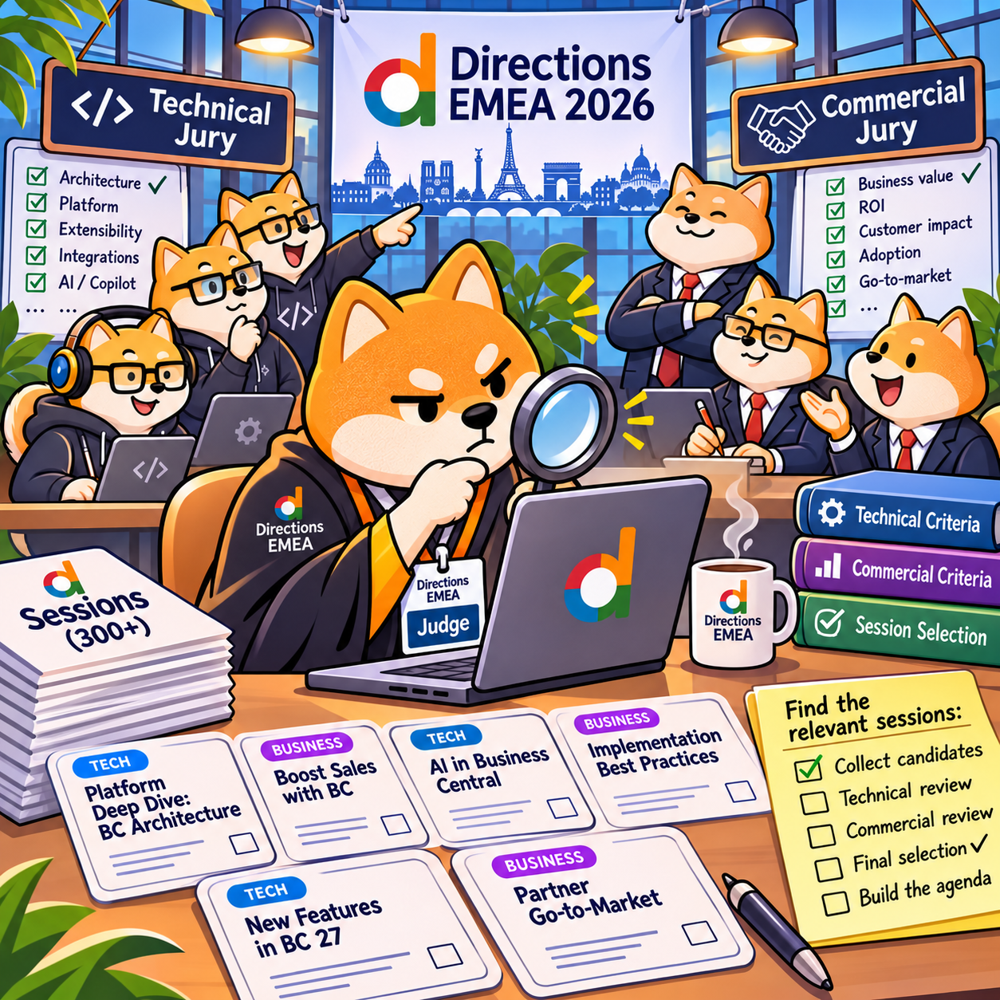
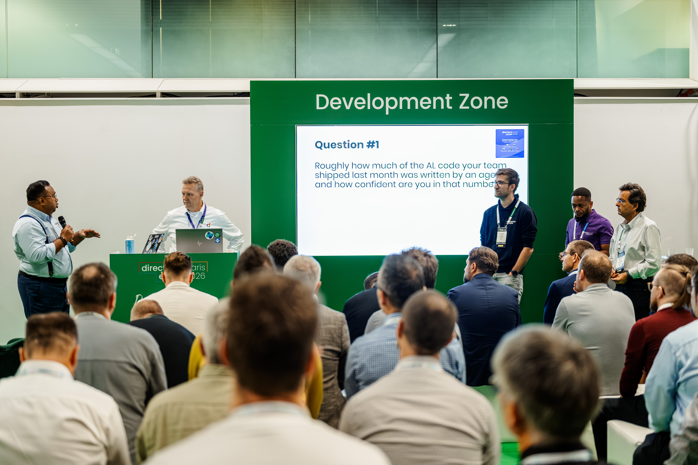
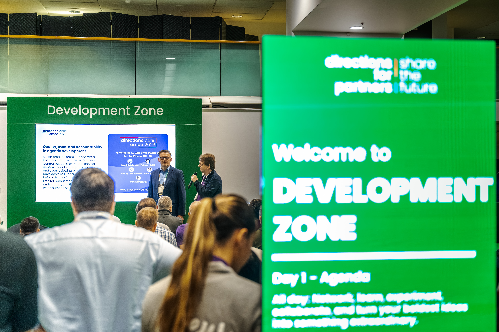
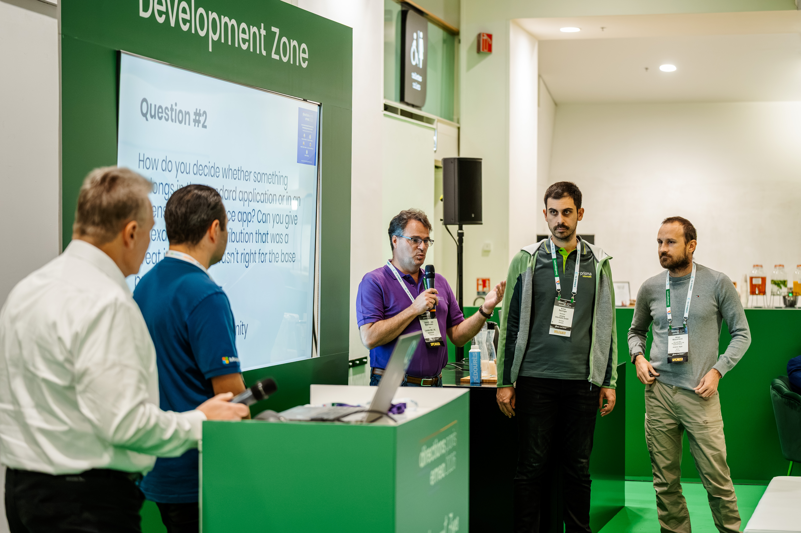
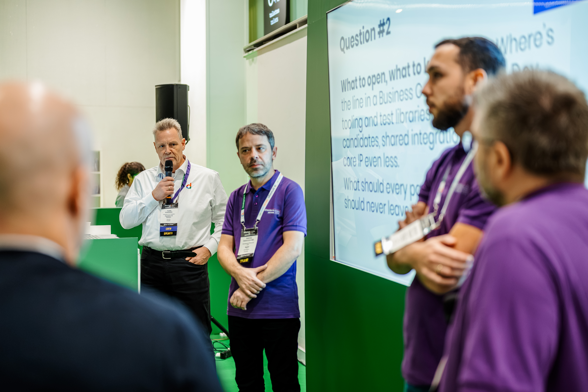
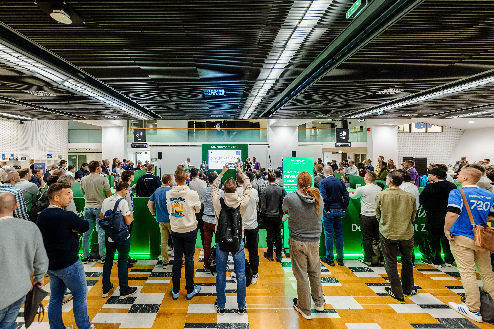
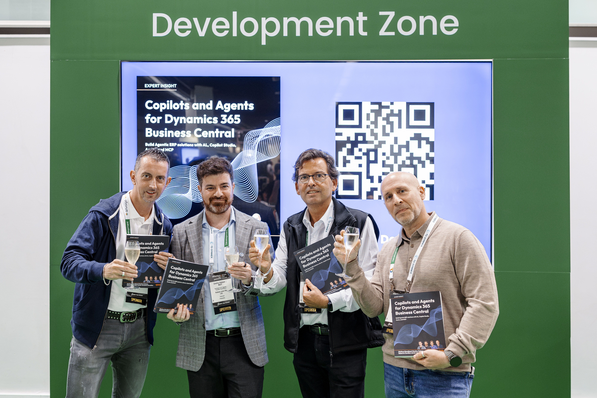
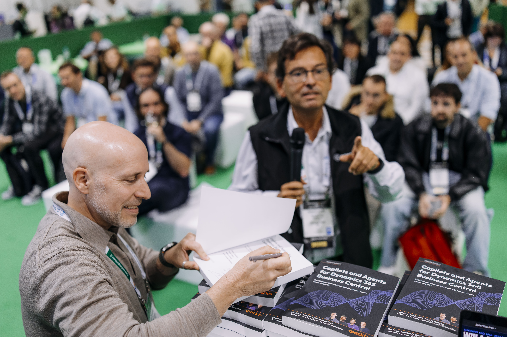
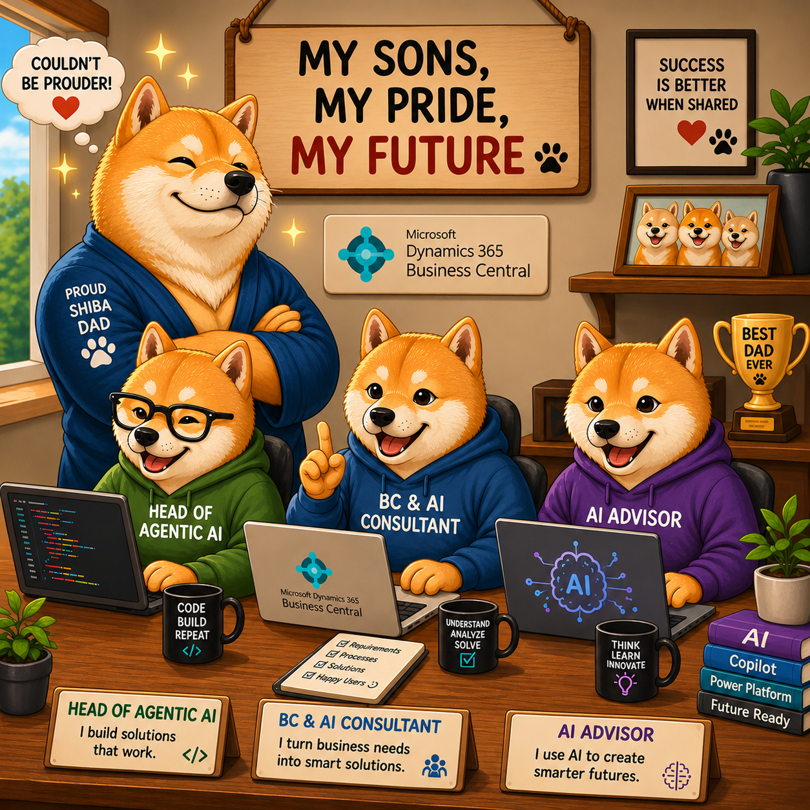
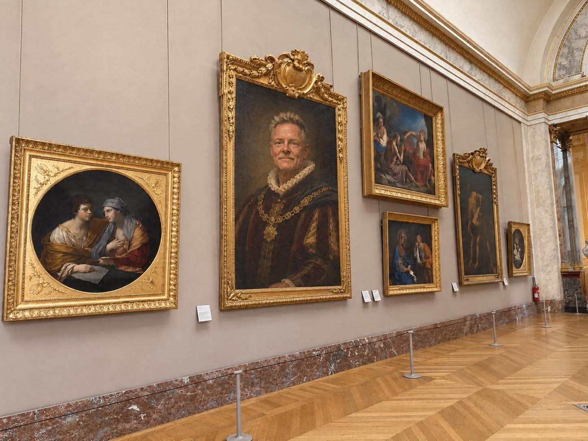

I think I have attended every Directions EMEA except the first, in Disneyland Paris in 2008. Until Poznan last year, I went as a Microsoftee and a speaker. Some years I had a few sessions; at my busiest, eight or nine. Poznan was my first as a non-Microsoftee, and a very different, wonderful experience.

In Poznan, we introduced the Zone concept. The sessions and discussions were good, and the zones showed promise. We also learned what needed fixing and this year in Paris, we fixed it.

I also had a few other responsibilities...

Sorry for the long read, but it was really an intense week.

## Session selection and schedule

This year, I had overall responsibility for selecting sessions from non-Microsoft speakers. With more than 800 submissions and about 100 sessions to choose, it wasn't an easy task. The priorities were clear:

- The split between sessions for various audiences should reflect the approximate split among participants
- There should be sessions for every type of audience in every timeslot
- No speaker should have more than two sessions (or one full session and two half sessions)
- No speaker should have two sessions on the same day
- Diversity matters, including in speaker selection
- MVPs, our trusted community leaders, should host no more than about half of the sessions
- Aim for a better average session rating than last year. (We can't improve every year, of course: in Poznan, the average session score was 4.49 and the average speaker rating was 4.61.)

Obviously, I wasn't the all-powerful, all-deciding, all-cruel judge. We had a technical jury for consulting and developer sessions, and a commercial jury for leadership, sales, and marketing sessions. I made the first pass, shortlisting about 100 technical and 100 commercial sessions for the juries to review.

Today, after the ratings are in - Directions EMEA 2026 got an average session score of 4.51 and the average speaker score was 4.65 - it isn't getting easier to make the cut guys...

## Know before you go

Approx. a week before Directions EMEA 2026, I hosted a "Know before you go" session for all speakers, giving them all the info needed for speaking at Directions EMEA 2026, we are ready! Most speakers joined and it was fairly clear that the speakers that didn't was missing this information.

We will redo these sessions next your and if you are selected a speaker - make sure to go to make your life easier.

## The setup

In the old days, people attending Directions used to stand in lines to get their badges and sometimes this would take a lot of time.

This year, I didn't see anybody waiting for more then a few minutes before they had a badge, not before the welcome reception and not before the first keynote. The Directions Team has spend the last 3 years optimizing this process, a work that is never really done, but it actually works pretty well when everything is setup.

The setup was done on Monday and we were ready to start scanning people a few hours before the welcome reception. During the actual scanning I was just a techical support for the team,everything went smooth.

## Session room assignments

Room assignments is a puzzle and after doing the intial room assignments, I looked into the tool every day to see if any rooms where overfilled to see if we could swap them around. For workshops this unfortunately wasn't possible as we only had one room with a classroom setup - my recommendations to those are come early and have a backup plan.

BTW thanks a million to Vjeko for providing an overview in the Confrenzy tool, which also works for colorblind people:-)

## The Developer Zone

In the Developer Zone this year, I had 5 roundtables, 2 sessions and one book presentation.

For every roundtable, I had picked 4 speakers and prepared a series of questions to get the discussion going. You can find the description of the sessions and download the questions (presentations) by clicking the links below.

#### [Roundtable #1: The Next AL Developer: Coder, Architect, or Agent Manager?](https://www.directionsforpartners.com/community/events/upcoming-events/directions-emea-2026/schedule?tab=%23EventScheduleTabName_2&session=1360272)

Speakers: Tine Staric (MVP), Msangi Masera (MVP), Roberto Corella (MVP) and AJ Ansari (MVP)

At first, the participants didn't agree on much. But as the discussion went on, they began to converge on this: the most valuable Business Central professional of the future may be a kind of solution architect, with enough development knowledge and a deep understanding of business processes and Business Central.

**Note**, the panels wasn't questions with a right or wrong answer. It was about opinions and predictions. I think the conclusion in this one makes sense, and I don't think I steered the discussion too much.

Speaker ratings: 4.45

### [Roundtable #2: AI Writes the AL. Who Owns the Result?](https://www.directionsforpartners.com/community/events/upcoming-events/directions-emea-2026/schedule?tab=%23EventScheduleTabName_2&session=1360271)

Speakers: Vjekoslav Babić (MVP), Andrzej Zwierzchowski (MVP), Kamil Sáček (MVP) and Krzysztof Bialowas (MVP)

The answer to the question is simple: You do, so the discussion turned into more like how do you make AI write code that you want to own...

I know (and have seen) the tools that some of these people are working with, but some things still came as a surprise. Vjeko probably have the most advanced tool/harness of all and he spends most of this time on the spec (which obviously mostly also is written by AI) and the suggested tests, which eventually shows what AI is going to implement and gives you a better picture than trying to review all the code.

There seemed to be consensus that the challenge is to ensure that AI is predictible and that you can validate the result.

Speaker ratings: 4.58

### [Roundtable #3: Our Code, Microsoft’s Product: Co-developing Business Central](https://www.directionsforpartners.com/community/events/upcoming-events/directions-emea-2026/schedule?tab=%23EventScheduleTabName_2&session=1360268)

Speakers: Miljan Milosavljevic (MVP), Jesper Schulz-Wedde (MS), Arend-Jan Kauffmann (MVP) and Kilian Seizinger (MVP)

Jesper from Microsoft opened the session by sharing Microsoft's open-source journey. The panel discussed what has and hasn't worked. All the panelists have contributed to the BCApps repository and shared their experiences. Jesper took notes and will follow up on the things he can address.

Personally, I left with one TODO: add one-click BCApps support to Fkh (Freddy's Kubernetes Helper). This would let partners using Fkh collaborate on and contribute to BCApps without the steep onboarding barrier.

Ratings: 4.71

### [Roundtable #4: Is the future of Development Open Source?](https://www.directionsforpartners.com/community/events/upcoming-events/directions-emea-2026/schedule?tab=%23EventScheduleTabName_2&session=1371499)

Speakers: Javier Armesto (MVP), Torben Leth (MVP), Andrzej Zwierzchowski (MVP) and Stefan Maroń (MVP)

With AI, you can re-engineer almost anything in very little time. What does that mean for partners whose value lies mainly in the code in their apps? I think they may find it harder to sell. What matters is the value customers get. If an app is priced fairly, supported, and maintained, customers will buy it when its value exceeds its price.

We discussed open source (public IP) versus closed source (private IP). Microsoft has open-sourced the Base Application, System Application, and localizations, but not the platform. The question is how to use open source and ensure projects remain maintained and secure. We didn't reach a conclusion, but we did shed light on the costs and shared responsibility involved.

We also discussed which projects are typically open-sourced and what partners prefer to keep proprietary. The panel largely agreed on that.

Ratings: 5.00

### [Roundtable #5: Coding with Agents: What Actually Works?](https://www.directionsforpartners.com/community/events/upcoming-events/directions-emea-2026/schedule?tab=%23EventScheduleTabName_2&session=1360273)

Speakers: Erik Hougaard, Tom Kapitan, Dmitry Katson and Eric "Waldo" Wauters

Another packed session about what actually works when coding with agents. The panelists used AI in different ways. Some used their most capable models for specifications and architecture, then handed coding to other models. Others used one top model for everything. Like the earlier roundtable, "AI Writes the AL. Who Owns the Result?", this panel came back to the same point: you're responsible for what you ship, so you need a way to verify AI's work. Without that, you're running blindfolded through a minefield.

Ratings: 4.75

### Sessions

There were two additional sessions in the Developer zone. Unfortunately, I wasn't able to attend any of these, but from what I heard, they were well attended and went fine.

### Book presentation

Shortly before Directions, Stefano, Dmitry, Roberto and Javier published a book called [Copilots and Agents for Dynamics 365 Business Central](https://www.amazon.com/dp/1806106590). During directions, they popped a champagne bottle and made a drawing of 3 signed copies of the book.

A packed room and live signing going on:

## Takeaways

I took away a lot from Directions EMEA 2026.

First, AI agents are here. Partners who know how to use them are already seeing gains in efficiency, performance, and quality. Others are still working to catch up.

Second, AL-Go for GitHub is becoming a popular DevOps choice among partners, and Microsoft is committed to investing in and supporting it for the partner channel. I'm very happy about that. I'd be sorry to see my baby thrown out with the bathwater.

Third, the Business Central MVP group and wider community feel like family, always ready to welcome new people. Over the past few years, two of my three sons have become active in the channel, and my wife helps too. The Directions party feels like a family gathering where I get to invite a few thousand friends without picking up the tab.

Fourth, more people are talking about open source and recognizing that projects need maintenance, support, contributions, and sponsorship. Whether the Business Central community can make it work remains to be seen.

And finally, the Directions team continues to amaze me. Their professionalism and the quality of the conferences keep improving, even as each new location brings fresh challenges. I can't name everyone who makes it happen, but I want to thank Adela for her invaluable work behind the scenes. She makes things happen. Thank you, Adela.

## Family

Quite a few people asked me about the two other "Dalgas Kristiansen" professionals attending Directions - are they your sons?

And yes, I am the proud father of 3 boys (they are actually men now, but for me they will always be boys), of which two are full time in the Business Central channel, Mads in Abakion and Jonas in the App Channel. They have already made significant impact in the community and are really making a name of themselves. Couldn't be more proud and happy to see that they both made a good impression on stage in panels and ISV sessions this year.

BTW. Niklas, my oldest son, is in Chemical Engineering and is likely not joining the Business Central community, but we never know...

## After-days

Having most of my family there, we stayed a few days in Paris to see the Eiffel tower, the Louvre and a lot of other things, including trying the famous Lobster dog. Fortunately we didn't run into any of the demonstrations and riots and had a few amazing days. In the Louvre I found out that I must be a remote descendent of some famous french count on this painting*

## See you next year

Budapest is an amazing place and there is no better place to be a year from now if you are at a partner working with Business Central.

See you in Budapest on November 8th 2027 for the welcome reception...

> Painting* is obviously AI generated.

Enjoy

***Freddy***