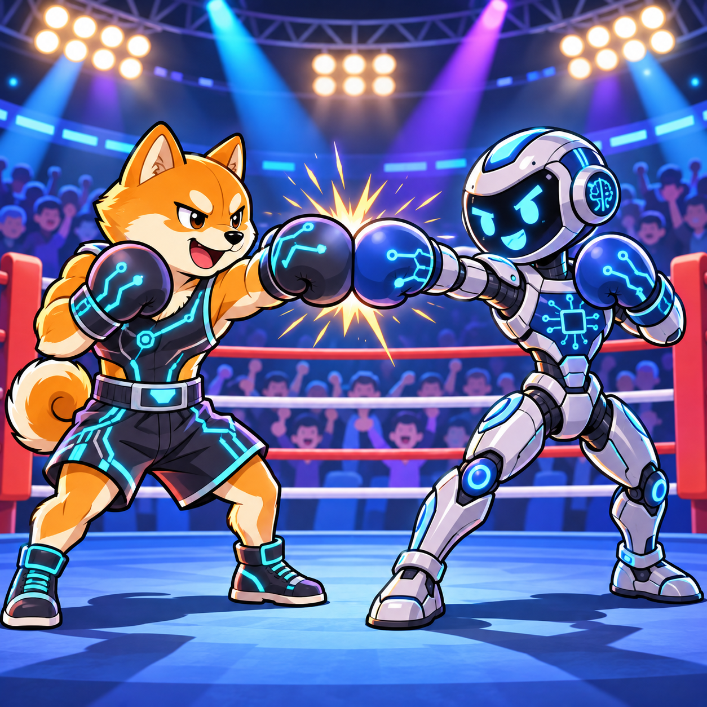
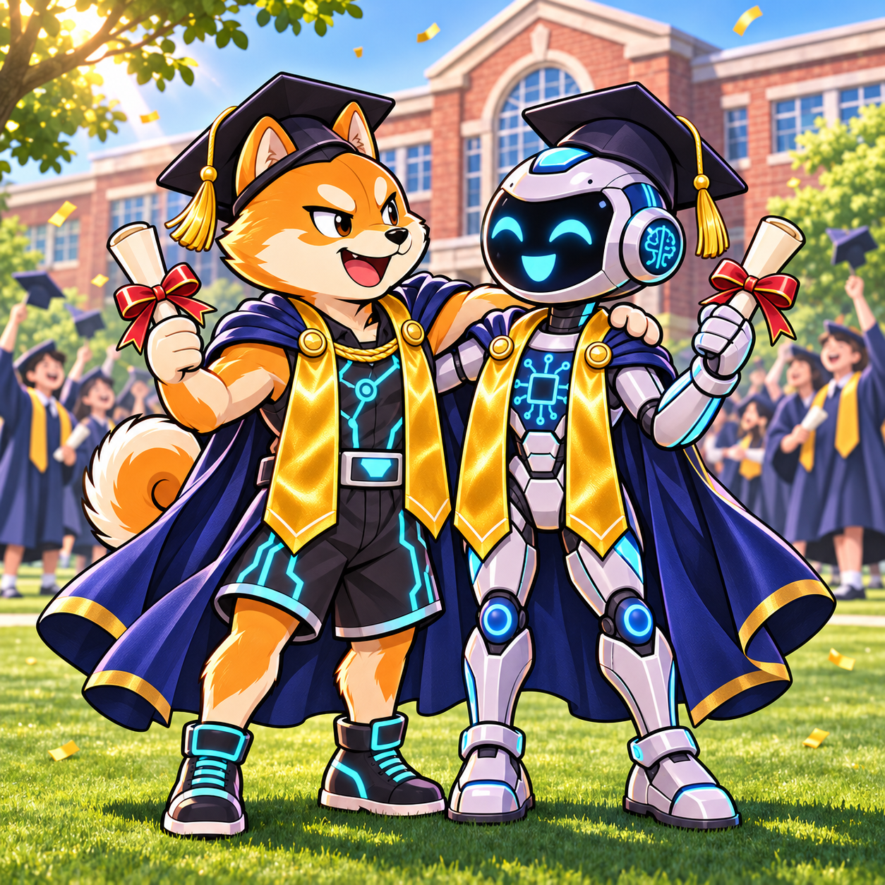
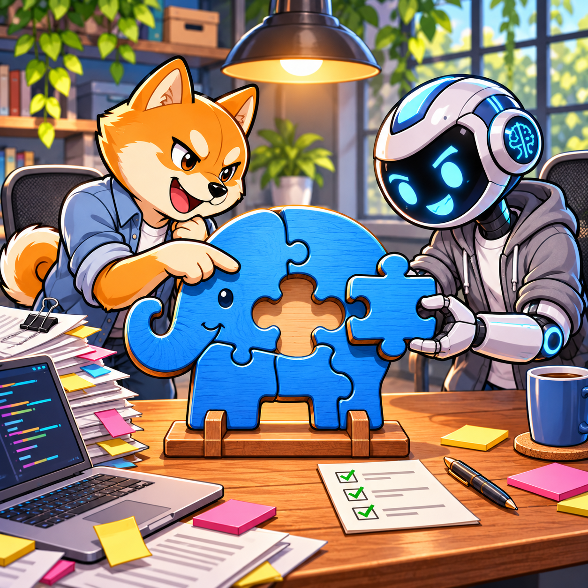
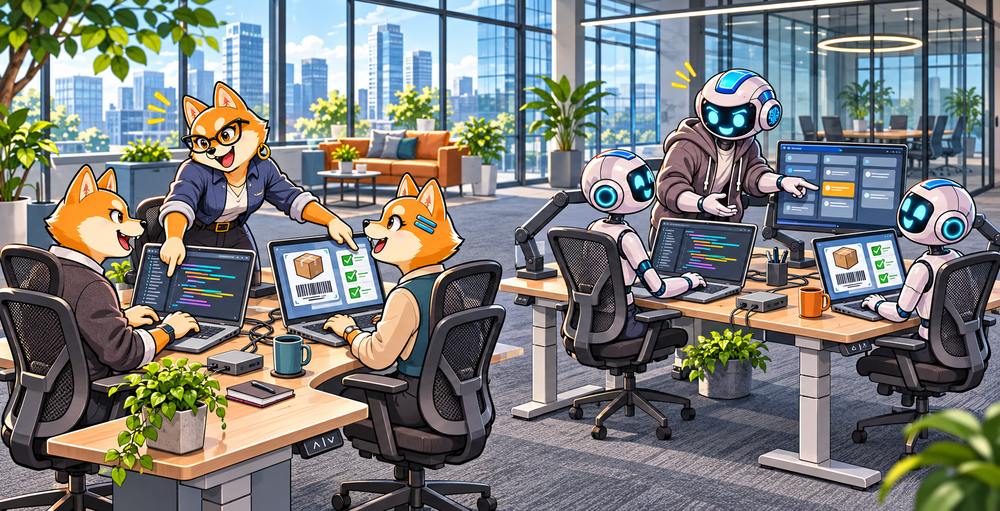

This blog post will try to map the various aspects of human intelligence to artificial intelligence.

Most companies have processes in place for hiring talent and making them a success in their unique workplace. My thinking is here that just as a human requires onboarding and training in "How we do things", the AI needs the same. Yes, an AI can do amazing things, but it can also make amazing mistakes if it hasn't been told how we do things... Just like humans.

How do humans gain the necessary knowledge and skills to perform a task and how does an AI do it?

Note that my comparisons need to be taken with a grain of salt and aren't intended to be a scientific description of how AI works.

## Intelligence == Model parameters

Human intelligence is defined as your ability to figure things out. On the AI side, the number of parameters can help the model solve harder problems. 

Intelligence is nothing without proper education though, and the same goes for AI: the number of parameters doesn't really matter if they haven't been trained.

Having said that, a higher level of intelligence also yields an increased ability to learn, and that also applies to AI models - the more parameters, the higher the ability to solve problems they haven't been trained to solve.

Higher intelligence (and larger models) also sometimes (not you obviously) tend to overthink tasks, which can be just as bad as jumping to conclusions, we need to find the right amount of effort to put into a task, which again is why it needs to be verifiable.

## Education == Training + Reasoning

In AI, the selected LLM always comes with model parameters + training and reasoning. Training a model is not an easy task. It requires a lot of compute to train a model with a trillion parameters.

Reasoning is the part of the education that teaches you to think a problem through step by step before answering, just like we were taught to show our calculations in math class instead of just writing down the result.

Anthropic hasn't released the sizes of their models, but [Alan D. Thompson](https://lifearchitect.ai/models-table/) estimates the models roughly as follows:

| Claude model | Total parameters |
|--------------|------------------|
| Haiku 5.5    | 400 billion      |
| Sonnet 5.5   | 2 trillion       |
| Opus 5.5     | 3 trillion       |
| Fable 5.2    | 10 trillion      |

Besides the total number of parameters, the various models also differ in how many active parameters per token are used, but for this comparison we will ignore that.

In a normal work environment, only a few tasks really require the highest education. In AI, we tend to ask the biggest model to do most tasks.

Human education is normally very narrow compared to AI training. Human education will take us in a specific direction, whereas most frontier models have no problems writing code, solving math problems and writing poems like Shakespeare. I don't think Einstein was quite as versatile.

This also might be one of the areas where we will be seeing AI change - is it really necessary to use a model that can draw like Da Vinci, write plays like Shakespeare, make music like Beethoven to write a simple AL function?

This is the way Microsoft is going with its MAI models and in the end, I think this is a better recipe than one model to know it all, but we are not there yet. 

## Experience + Specialized Education == Post-training

So, even though you got an education in computer science or software engineering, you are probably not proficient in AL. Yes, you might quite easily be able to learn the syntax and the capabilities of the language, but for many tasks, you also need to learn how Business Central works. The business processes, the why's, the do's, the don'ts.

These things are taught through experience and specialized education. In AI, most frontier models know quite a bit of AL coding and with the right harness and tools they are capable of solving quite complex tasks. But... do they know enough about the why's, the do's and the don'ts?

I cannot help thinking that a good coding model post-trained on AL and Business Central business processes might be better (and much cheaper) at creating apps than a frontier model that can do everything in the world.

## Project experience == AGENTS.md

Experience from current projects is typically something we as developers have in our heads. In complex codebases, we would frequently ask the person who knew about a certain part of the code to be the reviewer as they would remember why things were done in one way or the other.

Many developers probably also remember coming back to a piece of code after a year on other projects, thinking: "What was I thinking?" This is exactly the knowledge AGENTS.md is meant to capture.

When using AI, the experience is written in files like AGENTS.md (or CLAUDE.md / copilot-instructions.md), which basically contain the experience from this area of the codebase. Without giving this information to AI, AI will have to spend more tokens to search the codebase for patterns and usage and will more frequently get things wrong due to context window overflow.

## Memory + Information in front of you == Context

As humans, we remember what we did yesterday, what the customer told us last week and which mistakes we promised ourselves never to make again. Besides this, we have the specification, the code and maybe a few documents open in front of us - nobody can keep the entire project/codebase in their head at once. We do not get everything written down, so things might fall between the cracks.

AI is not that different: the context window is the AI's desk, and just like a messy desk, putting too much on it makes it harder to find what really matters. AI will try to compress the context window and keep what is really important, but this process is not visible to us. We do not know what AI determines as most important and what not, but we can influence it.

For both humans and AI, if you keep the individual tasks manageable and verifiable, both have a better chance to succeed. It is like the good old saying: How do you eat an elephant? One bite at a time!

If you give the AI (or the human) a task which is too big for the person or the model, you will get a bad result and unfortunately it is impossible to know up front what size of task the various models can handle.

To make things worse, AIs might go ahead and solve the task thinking that they did a good job. Humans will (if given the right values) say that this is not manageable and ask for the task to be broken down.

This is where you need processes in place to break down projects into manageable tasks, which in the AI world is called the harness.

## Workplace processes and rules == Harness

In a company, you follow rules about what you are allowed to do, which processes to follow and who needs to approve your work. Company policies also describe how tasks are broken down, how tasks are delegated to other members of the project and how delivery of completed sub-tasks is handled.

The harness (like Claude Code or GitHub Copilot) is the workplace for the AI, defining what it can see, what it can do, when it needs to ask for permission and how autonomously it is allowed to work. The harness provides the mechanisms, but your processes and rules still need to be written down for the AI to follow them.

Many Business Central partners didn't have a structured description of their processes and rules until they started implementing DevOps a few years ago. DevOps forced structure into the processes, and this helps immensely when implementing AI.

Companies without DevOps processes might struggle to implement an AI harness from scratch, even though we have things like [BCQuality](https://github.com/microsoft/BCQuality) and [AL-Go for GitHub](https://github.com/microsoft/AL-Go), which can help partners quite a bit when getting started. Besides that, partners should consult professionals who know more and have tried this before.

## Tools you work with == MCP/Tools

A developer needs VS Code, the AL Language extension and a ton of other extensions and apps to be productive, no matter how smart they are.

MCP servers and tools give the AI the same abilities - to compile, run tests, query data and look things up instead of just guessing.

Tools are also what keeps both humans and AI honest. You might be convinced that your code is correct, but the compiler and the tests will tell you otherwise - and the same goes for AI. Without tools, AI can only produce something that looks right; with tools, it can verify that it actually works.

But just like a developer with 200 extensions installed doesn't get more productive, giving the AI too many tools fills up the context window with tool descriptions and makes it harder for the AI to pick the right one.

Depending on where the AI is running, some of the tools might be the same, but if agents are running autonomously then local Docker is not an option. For this, I have created [Fkh](https://github.com/Freddy-DK/Fkh) (Freddy's Kubernetes Helper), more about that at a different time.

## Routines you know by heart == Skills

After doing the same task a number of times, you don't have to think about how to create a new table extension or publish an app - you just know the routine. Skills are the AI's version of this, a written down recipe it can pick up when needed instead of figuring it out from scratch every time.

The difference between CLAUDE.md and skills is a bit like the difference between knowing the project and knowing a routine. CLAUDE.md is always loaded, whereas the AI only sees a short description of each skill and loads the full recipe when the task calls for it - just like you don't walk around thinking about how to publish an app until you need to publish an app.

Skills can also be shared. When a new developer joins a team, they learn "how we do things here" from their colleagues - a skill is that knowledge written down, so every AI agent in the company does things the same way.

## Self-managing teams == Agentic loops

A self-managing team plans the work, splits it into tasks, does the work, reviews it and iterates until the job is done. Agentic loops do the same, with the AI planning, executing, verifying and correcting its own work - and just like with a team, you still need someone to define the goal and check the outcome.

A good team also has different roles - someone writes the code, someone else tests it and a third person reviews it. In agentic loops, this is done with sub-agents, each with their own role and their own clean desk (context window), so the reviewer isn't influenced by all the thoughts the developer had along the way.

The loop is only as good as the verification though. A team iterating without tests is just guessing in circles and so is an AI - which is why the tools and the harness from the previous sections are so important.

## Assignment == Prompt

In the end, the assignment or the prompt is what kicks off the job for the human or the AI. Together with all the things listed above, both humans and AIs will be able to do a good job, but if you skip any... - not so much.

Ignore the processes and the rules and you will get a solution of poor quality. Skip the post-training and you might end up having security vulnerabilities etc. etc.

Think about how you would give an assignment to a junior developer compared to a senior developer, who has been on the project for years. The junior needs every detail spelled out, whereas the senior just needs to hear "customers are complaining that the posting is slow, can you take a look?". With the right experience, skills, tools and harness in place, the AI gets closer to the senior and the prompt can focus on what and why instead of how.

No matter who gets the assignment, describing what "done" looks like is always a good idea - otherwise neither the human nor the AI knows when to stop.

## Conclusion

When hiring humans, we tend to hire the right person for the job. We don't just hire the most intelligent person for every task.

Every time a new model is released, we tend to think that this model can do it all and this is the model we will use.

But in the end - all the intelligence in the world cannot magically just fix everything - you need the training, experience, context, harness and everything else. With all of this in place, you might find that you don't need superior intelligence for all tasks and you will save a lot of money at the same time...

Note, that the things that make a team of humans successful are kind of the same things that make utilizing AI successful, the work behind making things happen is quite different though. Just make sure that you have all the other things don't skip any of the vital steps, it will come back and haunt you.

Enjoy

***Freddy***
